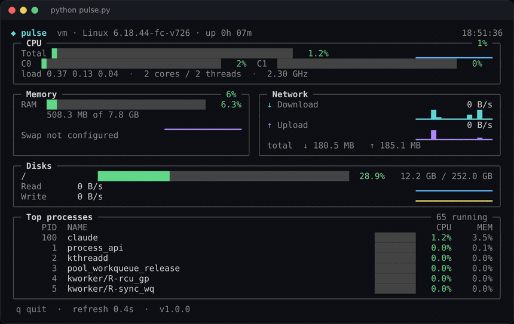

# Pulse

A live, colorful system performance monitor for your terminal — CPU, memory, disks, network and top processes with usage bars and history sparklines, in a single Python file.



> The demo above was recorded under synthetic load (CPU burners, a memory hog, loopback network traffic and disk writes) so every panel has something to show.

## Features

- **CPU** — total usage with history, per-core bars, load average, frequency, temperature and battery when available
- **Memory** — RAM and swap usage with a history sparkline
- **Network** — live download/upload speed with sparklines and totals
- **Disks** — usage per partition, plus live read/write speed
- **Top processes** — the busiest processes by CPU with memory usage
- **Color-coded** — green below 50%, yellow below 80%, red above
- **Responsive** — adapts its layout to your terminal width
- **Cross-platform** — Linux, macOS and Windows 10+
- **Tiny** — one file, one dependency ([psutil](https://github.com/giampaolo/psutil))

## Quick start

```bash
git clone https://github.com/<your-username>/<your-repo>.git
cd <your-repo>
pip install -r requirements.txt
python pulse.py
```

Press **q** (or Ctrl+C) to quit.

## Usage

```bash
python pulse.py              # live dashboard, refreshes every second
python pulse.py -i 0.5       # refresh twice a second
python pulse.py --once       # print one snapshot and exit
python pulse.py --once --no-color --width 100 > snapshot.txt
```

| Option | Description |
| --- | --- |
| `-i`, `--interval` | Refresh interval in seconds (default `1`, minimum `0.2`) |
| `--once` | Print a single snapshot and exit |
| `--width` | Width used by `--once` (default: terminal width) |
| `--no-color` | Strip colors (with `--once`) |
| `--version` | Show the version |

For the best result use a terminal with 256-color support at least 80 columns wide (Windows Terminal, iTerm2, GNOME Terminal and most modern terminals work great).

## How it works

`pulse.py` samples the system with `psutil`, keeps a short history for each metric, and redraws the whole dashboard in place using ANSI escape codes on the terminal's alternate screen — so your scrollback stays clean when you quit. Process CPU is shown as a share of total CPU capacity, matching the Total bar.

## Customization

Tweak the constants at the top of `pulse.py`:

- `HISTORY` — number of samples kept for sparklines
- `TOP_N` — processes shown
- `MAX_DISKS` — partitions shown
- the color constants (`GREEN`, `YELLOW`, `RED`, ...) are 256-color codes you can change to retheme

## License

MIT
